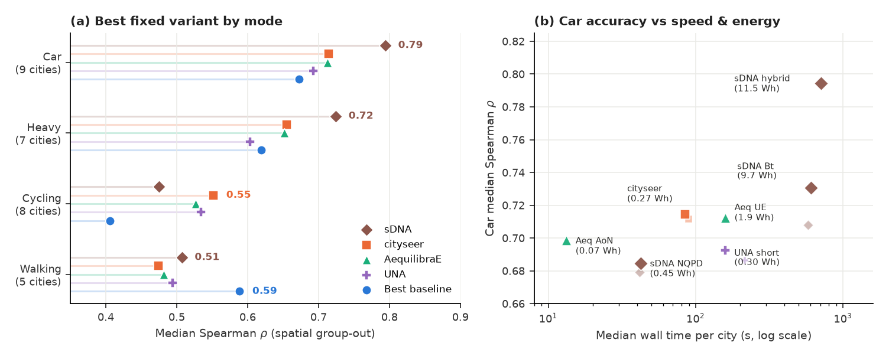

# AADTBench

An open benchmark for street-level multi-modal traffic estimation (walking, cycling, car, and heavy vehicles) across **9 cities on 3 continents** (8 open cases + Leuven non-commercial). Any tool that writes one flow per link can be scored on equal terms.

**[Leaderboard](https://robinlovelace.net/aadtbench/leaderboard.html)** · **[Paper](https://robinlovelace.net/aadtbench/paper/)** · **[Specification](BENCHMARK.md)** · **[Add a tool](IMPLEMENTATIONS.md)** · **[Full CSV](leaderboard-summary.csv)**

## Headline results

<!-- LEADERBOARD:START -->
| Tool | Tier | Car (9) | Heavy (7) | Cycling (8) | Walking (5) | Median wall* | Wh/city* |
| --- | :---: | :---: | :---: | :---: | :---: | ---: | ---: |
| **sDNA** | `T0` | **0.794** | **0.724** | 0.475 | **0.507** | 41 s–11.8 min | 0.43–11.5 |
| **cityseer** | `T2` | 0.714 | 0.655 | **0.552** | 0.474 | 87 s | 0.30 |
| **AequilibraE** | `T2` | 0.712 | 0.652 | 0.527 | 0.481 | 13 s–2.6 min | 0.07–1.9 |
| **UNA** | `T1` | 0.692 | 0.604 | 0.534 | 0.494 | 3.1 min | 0.37 |
| Best baseline | `T1` | 0.673 | 0.619 | 0.406 | 0.589 | <1 s | <0.01 |

_Median spatial group-out Spearman ρ across all cities with ≥ 20 sites (best fixed variant per tool; **bold** = top open tool per mode). Top variants: Car/Heavy = `sDNA mode_hybrid` (log R² = +0.50 / +0.45); Cycling = `cityseer dispersed` (0.552; `UNA default` wins 4/8 cities); Walking = `baseline attractor_density` (0.589), `sDNA bt_eucl` (0.507), `cityseer dispersed` (mean 0.520), `AequilibraE UE` (mean 0.510). *Per-city wall time and TDP-proportional CPU energy across variants (fastest to heaviest)._
<!-- LEADERBOARD:END -->



> Results cover 4 open tools (11 fixed variants) and 4 mandatory baselines on raw OpenStreetMap networks (Oxford, Leeds, Bristol, London, Paris, Melbourne, Zurich, Toronto, plus Leuven on its own non-commercial board). See the [interactive leaderboard](https://robinlovelace.net/aadtbench/leaderboard.html) or [paper](https://robinlovelace.net/aadtbench/paper/) for per-city scores, leave-one-city-out transfer, and variant ablations.

## Quick start

Every tool runs in its own GHCR container (`ghcr.io/robinlovelace/aadtbench-<tool>:latest`), so only the lightweight harness is needed on the host:

```bash
pip install -r requirements.txt
python -m benchmark.fetch --version v0.1.0 --case oxford-v1
python -m benchmark.run_all --cases oxford-v1 --tools baselines cityseer_od aequilibrae una sdna --docker
```

Smoke-test a single tool on the CI mini case:

```bash
python -m benchmark.smoke --tool aequilibrae --docker
```

Run `scripts/run_board.sh` for the full default suite and `scripts/update_readme_results.py` to refresh the headline table and hero figure above.

## Data, results, and contributing

- **Code & results:** Git holds the harness, adapters, and the complete scored leaderboard ([`leaderboard-summary.csv`](leaderboard-summary.csv), all variants and splits).
- **Case bundles:** Networks (OSM, ODbL), WorldPop population (CC BY 4.0), and reviewed open counts live in the [v0.1.0 release](https://github.com/Robinlovelace/aadtbench/releases/tag/v0.1.0), verified by SHA-256 on download.
- **Contribute:** New tools, cities, and rule proposals are welcome via issues and pull requests — see [`BENCHMARK.md`](BENCHMARK.md) for the rules and [`IMPLEMENTATIONS.md`](IMPLEMENTATIONS.md) for the adapter contract and container images.
